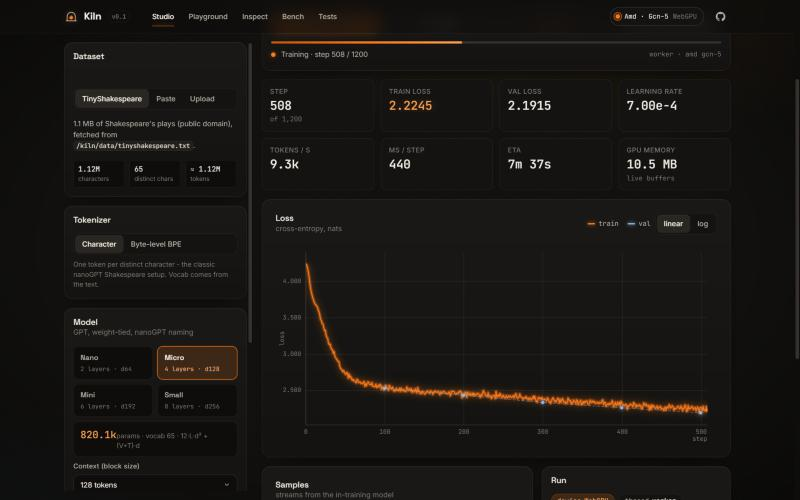
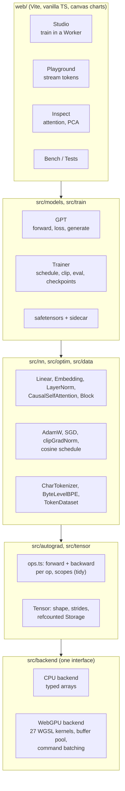

# Kiln

A deep-learning framework written from scratch in TypeScript, with a WebGPU backend, that trains a GPT live in a browser tab.



**Try it:** <https://rahultarigoppula.github.io/kiln/> (Chrome or Edge 113+, Safari 26+, Firefox 141+ on Windows; anything else runs the CPU backend). The Studio trains a character-level GPT on your GPU inside a Web Worker, the Playground samples from a shipped checkpoint with per-token probabilities, Inspect draws attention heatmaps and an embedding PCA, Bench compares the WGSL kernels with the CPU backend, and Tests runs the GPU/CPU parity suite.

No PyTorch, no TensorFlow.js, no WASM: every kernel, the autograd engine, the optimiser, the tokenizer and the training loop are in this repository. Zero runtime dependencies.

**Everything runs in the browser.** The web app is static files on GitHub Pages: training, generation and checkpoint export happen in your tab, text you paste or upload and the models you train never leave your device, and there is no analytics, telemetry or server of any kind. Training, Bench and the parity Tests need WebGPU; the Playground and Inspect pages fall back to the CPU backend.

## What is in the box

- **Tensor library** (`src/tensor`): f32/i32 tensors with NumPy broadcasting, zero-copy views (reshape, transpose, slice, expand), refcounted storage and a seeded xoshiro128** RNG.
- **Reverse-mode autograd** (`src/autograd`): 65 tensor ops, 44 of them with their own recorded backward (the rest are compositions), every one covered by a numerical gradient check; iterative topological backward that frees saved tensors as it goes.
- **Two backends behind one interface** (`src/backend`): a CPU backend on typed arrays (register-blocked GEMM) and a WebGPU backend with 27 hand-written WGSL kernels (see [docs/KERNELS.md](docs/KERNELS.md)), a size-class buffer pool, a uniform ring and dispatch batching into command encoders.
- **Deterministic scatter-add**: WGSL has no f32 atomics, so the embedding backward is a counting sort plus a fixed-order segmented sum. Results are bit-reproducible run to run.
- **Fused row kernels**: softmax and log-softmax with online max/sum, LayerNorm forward and backward, cross-entropy with its gradient in one pass, and a fused AdamW update (one dispatch per parameter).
- **Scoped memory management**: no GC for device buffers; `tidy()` frees every intermediate a step creates, parameters and optimizer state are escaped by their owners, and a test asserts the live buffer count is flat across training steps.
- **Tokenizers** (`src/data`): character level and byte-level BPE (GPT-2 style byte-to-unicode mapping, regex pre-tokenisation, trainable, exact round trip).
- **GPT** (`src/models`): nanoGPT layout and parameter names, weight tying, causal attention, generation with temperature / top-k / top-p, attention capture for visualisation.
- **Trainer** (`src/train`): AdamW with nanoGPT weight-decay groups, cosine schedule with warm-up, global-norm clipping without readback, gradient accumulation, eval and sampling callbacks, pause / resume / stop, resumable checkpoints.
- **safetensors checkpoints**: standard layout plus a JSON sidecar (config, tokenizer, training log). The shipped models load in the browser from a URL.

## Architecture



The rule that keeps this honest: `tensor` and `backend` know nothing about autograd, `autograd` is written once against the `Backend` interface, and everything above only uses autograd ops. The full contract is in [docs/ARCHITECTURE.md](docs/ARCHITECTURE.md).

### How a training step flows

1. `Trainer.trainStep` draws a random `(x, y)` batch from the `TokenDataset`, uploads both as i32 `[B, T]` tensors and opens a `tidy()` scope.
2. `GPT.forward` runs eagerly. Each op (embedding gather, LayerNorm, the `[C -> 3C]` projection, `q k^T`, masked softmax, `att v`, GELU MLP, ...) calls the backend immediately. On the CPU the result is ready when the call returns; on WebGPU the call records a dispatch into the current command encoder and returns a tensor whose storage is a `GPUBuffer`. Every op also records a `Node` with the inputs it needs for backward and only the fresh tensors it saved.
3. The fused cross-entropy kernel produces the loss and its gradient in one pass; `loss.backward()` walks the graph in reverse topological order, calls each node's backward closure (itself a scope), accumulates gradients onto the leaves, and frees saved tensors as soon as they are consumed.
4. The scope ends: everything created during the step except the detached loss is freed, which on the GPU means the buffers return to the pool.
5. `clipGradNorm` computes `sqrt(sum of sum-squares)` entirely on the device, scales the gradients, and returns the norm as a 0-d tensor. `AdamW.step` is one fused dispatch per parameter; `zeroGrad` frees the gradient buffers.
6. Once per `lossReadbackInterval` steps the pending losses and norms are stacked and read back in a single `mapAsync`, which is the only host sync in the loop. The command batch is also submitted whenever 64 dispatches have accumulated. After the readback the loop yields one macrotask so `pause()` / `stop()` and the UI get a turn.

## Benchmarks

Measured in the Bench page of the web app on a laptop with an AMD Ryzen 7 5800H and its integrated Radeon GPU (reported by WebGPU as `amd / gcn-5`), Chromium, Windows 11. The CPU column is a single JavaScript thread and was taken while other processes kept the CPU at 100% load, so treat it as a lower bound. GPU numbers are wall-clock around enqueue plus `sync()`.

| Kernel | Size | CPU | WebGPU | Speedup |
| --- | --- | ---: | ---: | ---: |
| matmul f32 | 128 x 128 x 128 | 1.29 GFLOPS | 2.4 GFLOPS | 1.9x |
| matmul f32 | 256 x 256 x 256 | 1.83 GFLOPS | 170 GFLOPS | 93x |
| matmul f32 | 512 x 512 x 512 | 1.96 GFLOPS | 273 GFLOPS | 139x |
| matmul f32 | 1024 x 1024 x 1024 | 1.30 GFLOPS | 433 GFLOPS | 333x |
| matmul f32 | 2048 x 2048 x 2048 | (skipped) | 450 GFLOPS | |
| add (a + b) | 4M f32 | 5.4 GB/s | 18.0 GB/s | 3.3x |
| gelu | 4M f32 | 0.44 GB/s | 15.8 GB/s | 36x |
| softmax rows | 8192 x 1024 | 50 k rows/s | 2.72 M rows/s | 54x |
| layernorm rows | 8192 x 1024 | 135 k rows/s | 2.58 M rows/s | 19x |

End to end, the Studio trains the `micro` preset (4 layers, 4 heads, d = 128, context 128, batch 32, 820 k parameters, char-level TinyShakespeare) at about 6 k tokens/s (350 to 700 ms per optimizer step depending on what else the machine is doing, roughly 1,300 kernel dispatches per step) on that integrated GPU, with GPU memory flat at 10.5 MB of live buffers for the whole run. Discrete GPUs are considerably faster; the per-dispatch cost measured in-browser is 20 to 60 microseconds.

CPU training step (Node 22, `nano` preset, batch 16, context 64, char-level, same loaded laptop): 280 to 360 ms per optimizer step, about 3.2 k tokens/s. A `node --cpu-prof` profile puts 76% of the step inside the two GEMM kernels (`gemmRows4` 59%, `gemmNT` 17%) and no other function above 4%, so the CPU path is compute-bound rather than overhead-bound; a 4x2 register block for the NT kernel was tried and rejected (2x slower under V8, presumably register spilling), so the 2x2 block stays.

GPU parity suite (Tests page, same machine): 165 of 165 cases pass in 2.5 s on the AMD integrated GPU; the headless CI run on a GPU-less runner reports "WebGPU unavailable" and exits 0.

## Example

`examples/train-gpt.ts` (run it with `npm run example`; about a minute on a CPU):

```ts
import { manualSeed, tidy, Tensor, CharTokenizer, TokenDataset, GPT, Trainer, optim } from "kiln";

const text = "To be, or not to be, that is the question: ".repeat(400);
const tok = CharTokenizer.fromText(text);
const { train, val } = new TokenDataset(tok.encode(text), 32).trainValSplit(0.9);

manualSeed(42);
const device = "cpu" as const; // "webgpu" after `await initWebGpu()` in a browser
const model = new GPT({ vocabSize: tok.vocabSize, blockSize: 32, nLayer: 2, nHead: 2, nEmbd: 64, dropout: 0, bias: true }, device);
const optimizer = optim.configureAdamW(model, { lr: 3e-3, weightDecay: 0.1 });

const trainer = new Trainer({
  model, optimizer, train, val, tokenizer: tok, device,
  batchSize: 16, maxSteps: 150, clipNorm: 1,
  lrSchedule: optim.makeCosineWithWarmup({ warmup: 10, total: 150, lrMax: 3e-3, lrMin: 3e-4 }),
  evalInterval: 50, evalIters: 4,
  callbacks: { onEval: (e) => console.log(`eval @ ${e.step}: val ${e.valLoss.toFixed(3)}`) },
});
await trainer.run();

const x = Tensor.fromArray(tok.encode("To be, or"), [1, 9], { dtype: "i32" });
const next = tidy(() => model.eval().forward(x).logits.argmax(-1)).dataSync()[0];
console.log(tok.decode([next as number]));
const out = await model.generate(x, 60, { temperature: 0.7, topK: 10, seed: 1 });
console.log(tok.decode(await out.data()));
```

Kiln is published as a source-only package: `package.json` points `exports` at `src/index.ts`, so you need a TypeScript-aware toolchain (Vite, tsx, Bun, Deno, or `tsc` with `moduleResolution: bundler`). There is no compiled `dist/` for the library.

## Project layout

```
src/
  tensor/      dtype, shape math, Tensor, Storage, RNG, scopes (tidy / keep / escape)
  backend/     Backend interface; cpu/ (typed-array kernels); webgpu/ (device, buffer pool, batching, kernels/, parity suite)
  autograd/    graph (Node, backward, noGrad) and ops.ts (forward + backward for every op)
  nn/          Module, Linear, Embedding, LayerNorm, Dropout, activations, CausalSelfAttention, Block, MLP, init
  optim/       Optimizer base, AdamW, SGD, clipGradNorm, LR schedules
  data/        CharTokenizer, ByteLevelBPE, TokenDataset
  models/      GPT, safetensors read/write, checkpoint sidecar, Node helpers
  train/       Trainer
  index.ts     public API
web/
  src/pages/   studio, playground, inspect, bench, tests, about
  src/lib/     engine adapter, worker session, charts, signals, PCA, bench harness
  src/worker/  training worker + protocol
  public/      TinyShakespeare, shipped checkpoints
tests/         vitest suites (Node, CPU backend)
scripts/       train-tiny.ts (CPU training to a checkpoint), bench-cpu.ts, gpu-parity.mjs (Playwright), lint-text.mjs
examples/      train-gpt.ts
docs/          ARCHITECTURE.md (module contracts), KERNELS.md (every WGSL kernel), screenshots/
```

## Shipped checkpoints

| Checkpoint | Config | Params | Trained on | Val loss | Size |
| --- | --- | ---: | --- | ---: | ---: |
| `shakespeare-micro` (default) | 4 layers, 4 heads, d128, T128, char vocab 65 | 802 k | WebGPU, Studio, 984 steps (batch 32 x 128 tokens), 17 min | 2.01 | 3.3 MB |
| `shakespeare-tiny` | 2 layers, 2 heads, d64, T64, char vocab 65 | 104 k | CPU, `scripts/train-tiny.ts`, 2272 steps | 2.02 | 0.44 MB |

Sample from `shakespeare-micro` (temperature 0.8, top-k 40, seed 7). The run was cut short by the time budget (cosine schedule planned for 1200 steps, lr 1e-3 with 60 warm-up steps, weight decay 0.1, dropout 0.1, clip 1.0); the training log in the sidecar has the val loss at every 100 steps (2.53 at step 100, 2.01 at step 900):

```
ROMEO:
So what aser, ou? and bother be shall as paitited.
Frauch I reate cond proursent they bes conted.

PORIO:
Thy will macl not with here sto and the hous and sprome, you to mot
When than my bone thath pant the slep a this wen.
```

## Testing

- `npm test`: 144 vitest cases in 15 files on the CPU backend: shape and stride math, every op against golden values, numerical gradient checks (106 `gradcheck` comparisons over 19 test cases, central differences, eps 1e-3), nn layers against reference computations, a GPT that learns to copy a sequence in under 30 steps (and generation from a prompt longer than `blockSize`), tokenizer round trips (including empty and whitespace-only input), safetensors round trips plus malformed-input rejection (non-JSON or non-object headers, non-integer offsets, negative or fractional shapes all throw a named error), the trainer (schedule, pause / resume / stop, checkpoint resume, resuming a finished run), and buffer-count flatness across training steps and generation.
- `tests/wgsl-syntax.test.ts`: every WGSL template is instantiated and checked for balanced braces, resolved placeholders and declared bindings without a GPU.
- **GPU parity** (`src/backend/webgpu/parity.ts`): every backend method runs on both devices with random inputs (odd sizes, broadcasting, batched and transposed matmuls, duplicate scatter ids, ignore-index rows, the two-stage and prime-row reduction paths) and the outputs are compared; 165 cases. Runs in the Tests page and headless via `npm run test:gpu` (Playwright + Chromium with SwiftShader flags; CI runs it as a best-effort job that does not block).
- `npm run typecheck` with `strict`, `noUncheckedIndexedAccess`, `verbatimModuleSyntax`; `npm run lint:text` bans typographic dashes, curly quotes and arrows in tracked files.

## Design decisions and limitations

- **Eager execution, no graph compiler.** Ops dispatch immediately; the WebGPU backend batches dispatches into command encoders and submits on readback or every 64 dispatches. This keeps PyTorch-like ergonomics at the cost of one JS call per op, so small models are dispatch-bound.
- **f32 only.** No f16 or bf16 storage or compute, which keeps CPU/GPU parity testing within 1e-4.
- **No fused attention.** Attention is `matmul`, `maskedFill(-inf)`, `softmax`, `matmul`, so the `[B, H, T, T]` score matrix is materialised; context lengths above a few hundred tokens are memory-bound.
- **Refcounted buffers, not a GC.** Device memory is freed by scopes and owners, not by the JavaScript garbage collector. Forgetting `tidy()` in a loop leaks; the memory test exists to catch that in the engine.
- **Readback is the only sync.** The trainer reads the loss back once per step (configurable), which costs latency on the GPU but keeps the UI honest about progress.
- **Contiguity.** WGSL kernels take contiguous inputs; non-contiguous views are materialised before a kernel runs, except transposed operands of `matmul`, which are fused into `transA` / `transB`.
- **Determinism over speed in scatter-add.** The counting-sort scatter is exact and reproducible, at `O(sum of segment^2)` cost in the ranking step, which is fine for token distributions but would be the wrong choice for gathers with huge duplicate counts.
- **Single bind group, uniform ring.** Every kernel takes a 256-byte uniform of parameters; dispatch limits (65535 workgroups per axis, batch of at most 65535 matrices) are enforced on the host.
- **Browser-first.** Node runs the CPU backend only (WebGPU in Node would need an external implementation, which the zero-dependency rule excludes).

## Roadmap

- Fused causal attention (flash-style tiles in WGSL) to drop the materialised score matrix.
- f16 storage with f32 accumulation on devices that expose `shader-f16`.
- Multi-pass scan and a radix-sort based scatter for very large vocabularies.
- Kernel timing with timestamp queries in the Bench page.
- KV-cache for generation and a BPE-tokenized shipped checkpoint.
- Mixed CPU/GPU pipelines (tokenizer in a second worker, prefetching batches).

## Licence

MIT. See [LICENSE](LICENSE). TinyShakespeare (`data/tinyshakespeare.txt`) is public domain.
